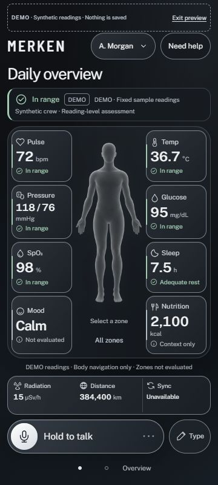

# Adaptación de la vista principal a móvil

Se compactó la composición para mostrar el estado general, las ocho lecturas, el cuerpo, el contexto y la entrada en una pantalla vertical habitual. Se conserva la dirección híbrida y la figura raster con sus proporciones originales.

## Cambios

- Cabecera y título más compactos; se retiran el lema y el texto introductorio redundante en móvil.
- La altura disponible se reparte entre las tarjetas, mediante flex/grid y `100dvh`. Se respetan `safe-area-inset-top/bottom` y no se bloquea el desplazamiento.
- Voz y escritura comparten una fila. `Type` mantiene el nombre accesible completo `Type a reading`.
- Las lecturas principales conservan al menos 22 px en el tamaño de letra inicial; presión utiliza 16–18 px. Las unidades y etiquetas secundarias mantienen la escala compacta previa.
- En Mood se muestra `Not evaluated`; el nombre accesible y el detalle conservan `Self-reported · Not evaluated`. La descripción completa se toma del estado original, sin concatenar las dos versiones visuales.
- Back y Other se acceden desde All zones en la composición móvil. La lista conserva las 14 zonas y sus estados.
- La selección del cuerpo conserva únicamente el tinte, sin marco.
- Una consulta al ancho efectivo del contenedor reorganiza la vista a dos columnas con el cuerpo encima cuando el espacio es muy estrecho, incluyendo texto ampliado. Contexto y entrada se apilan. Se permite scroll en este caso, en historial, en avisos y cuando el contenido necesite crecer.
- Sin dependencias nuevas; sin cambios al núcleo, a los umbrales ni al guardado.

## Validación en navegador

Los siguientes son perfiles de viewport representativos, en píxeles CSS. No equivalen a pruebas en hardware ni a una certificación de un modelo concreto.

| Referencia | Viewport | Documento | Resultado |
| --- | --- | --- | --- |
| Samsung | 360 × 800 | 360 × 800 | Vista completa, sin scroll horizontal ni vertical. |
| Pixel | 412 × 915 | 412 × 915 | Vista completa, sin scroll horizontal ni vertical. |
| iPhone Pro Max | 430 × 932 | 430 × 932 | Vista completa, sin scroll horizontal ni vertical. |

Se usaron las muestras sintéticas de `?preview=1`, incluyendo su banner de desarrollo visible. Las capturas son del viewport, no imágenes de toda la página ni imágenes estiradas.

- Los 19 controles HTML visibles de cabecera, vista principal y navegación alcanzan al menos 44 × 44 px. Las zonas anatómicas pequeñas mantienen All zones como alternativa.
- Ninguna tarjeta ni control medido presenta desbordamiento de su contenido en los tres perfiles.
- Se comprobó All zones (14 entradas), selección de Back y de Chest con Enter, detalle completo de Mood, formulario manual, historial y cambio a J. Rivera (pulso 78). El cambio de persona no duplica la etiqueta abreviada de Mood.
- Chest conserva `stroke: none` y `outline: none` al seleccionar.
- Prueba visual temporal de una etiqueta `Notify flight surgeons`: permanece completa y la vista sigue entrando en 360 × 800. No se modificó una regla ni se ejecutó un evento médico.
- Reserva adicional simulada de 24 px arriba/abajo para los perfiles Android y 59/34 px para Pro Max: la composición equivalente a la app, sin el banner exclusivo de desarrollo, entra completa. Se conservaron los distintivos DEMO de las muestras. Es una prueba de distribución con padding temporal, no una emulación del sistema operativo.
- Texto raíz al 200 % en 360 × 800: reflujo y scroll vertical, sin desbordamiento horizontal ni contenido recortado en tarjetas y entrada.
- 320 × 568: reflujo y scroll vertical, sin desbordamiento horizontal ni contenido recortado en tarjetas y entrada.
- Los cambios temporales de QA se retiraron recargando la página. El viewport se restauró al terminar.

Medidas detalladas: [validacion.json](validacion.json).

Compilación TypeScript/Vite y `git diff --check` correctos. Falta comprobar el WebView y las áreas seguras en teléfonos físicos.

## Capturas

- [Samsung, 360 × 800](samsung-360x800.jpg)
- [Pixel, 412 × 915](pixel-412x915.jpg)
- [Pro Max, 430 × 932](pro-max-430x932.jpg)

