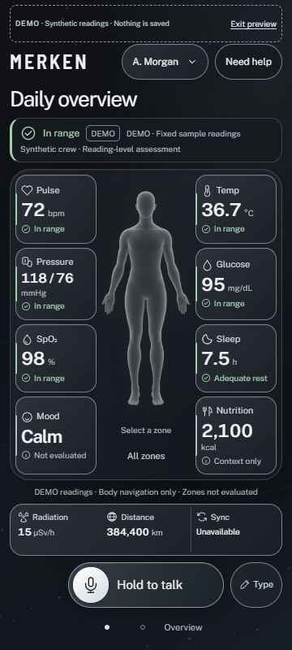

# Etapa 2 — partículas y micrófono centrado

Primera capa animada, integrada sobre la vista móvil compacta. Mantiene la estética híbrida oscura y neutral. No añade dependencias.

## Resultado

- `Hold to talk` queda centrado respecto de la pantalla, con una reserva simétrica de espacio y `Type` a la derecha. Su centro medido es 180, 206 y 215 px en viewports de 360, 412 y 430 px respectivamente.
- Canvas 2D fijo detrás de la interfaz: puntos grises suaves y tres corrientes amplias. No intercepta toques, no ocupa espacio de layout y queda fuera del árbol accesible.
- Al mantener pulsado el micrófono aumenta gradualmente la velocidad y las partículas cercanas se orientan hacia el control. Al soltar, la energía visual se disipa. Es actividad del botón, no energía de audio.
- Seleccionar una zona —también desde All zones o el detalle de una lectura— produce un impulso breve y neutral cerca de la figura. No cambia ni deduce estados de salud.
- El fondo se detiene fuera de Overview y cuando se oculta/suspende la página. Con movimiento reducido conserva una imagen estática. Con colores forzados se oculta.
- Sin Canvas disponible se conserva el fondo CSS y la interfaz funcional. El controlador dispone de limpieza de RAF, observadores y listeners al destruirse.

## Presupuesto inicial

- Objetivo: 30 dibujos/s mediante RAF limitado; no es un límite de refresco de la interfaz.
- 48–84 partículas reutilizadas según superficie; 48, 63 y 67 en los tres perfiles comprobados.
- DPR máximo de dibujo 1.5 y respaldo de Canvas limitado aproximadamente a 1.6 millones de píxeles. Las cifras y controles HTML conservan su resolución normal.
- Un sprite con borde suave precalculado; sin blur dinámico por partícula ni solicitudes de recursos por fotograma.
- El renderizador recibe solo actividad del botón y una posición de interacción; no recibe lecturas, audio ni transcripciones.

## Verificación

Compilación TypeScript/Vite y `git diff --check` correctos.

| Perfil representativo | Vista completa sin scroll | Centro del micrófono | Partículas |
| --- | --- | --- | --- |
| Samsung, 360 × 800 | Sí | 180 px | 48 |
| Pixel, 412 × 915 | Sí | 206 px | 63 |
| Pro Max, 430 × 932 | Sí | 215 px | 67 |

Se comprobaron los eventos reales de pulsación del botón en el navegador: durante una pulsación de un segundo, la energía visual alcanzó aproximadamente 0.74 a los 250 ms; al soltar se desactivó holding. La selección de Chest activa el impulso.

El contador de dibujos permanece constante en historial, al desactivar el efecto para comparación y con `prefers-reduced-motion: reduce` emulado. Se comprobó también `forced-colors` emulado. Los eventos de visibilidad y pagehide/pageshow se simularon para verificar la pausa/recuperación; no equivalen a una prueba del ciclo de vida Android/iOS.

Texto raíz al 200 %: el diseño permite reflujo/scroll, sin desbordamiento horizontal ni recortes en tarjetas o entrada. Una prueba aislada con contexto nulo verifica el respaldo y la destrucción del controlador. DPR 3 simulado conserva el límite de dibujo 1.5 (648 000 píxeles en 360 × 800).

Los cambios temporales de QA se retiraron. El viewport se restauró al finalizar.

### Primera muestra de costo en escritorio

En el navegador de desarrollo, a 360 × 800 y DPR 1:

- 120 dibujos en 4001.6 ms: **29.99 dibujos/s**.
- Últimos 120 dibujos: **0.10 ms p50 / 0.20 ms p95** de tiempo CPU del renderizador, incluyendo el envío de comandos de Canvas.
- Sin intervalos superiores a 2.1 veces el período objetivo en esa muestra.
- Al desactivar el efecto, cero dibujos adicionales durante 450 ms.

Son medidas breves del equipo de desarrollo. No miden tiempo completo de GPU, RAM total del proceso, consumo, temperatura ni rendimiento sostenido en un teléfono. Falta esa comparación en hardware móvil antes de sacar conclusiones sobre batería.

Build: JS 61.94 kB (20.98 gzip), frente a aproximadamente 57.44/19.10 kB antes de esta etapa; incremento aproximado de 4.50 kB de JS y 1.88 kB gzip. CSS 41.48 kB (9.06 gzip), frente a 41.19/9.00 kB. La ilustración corporal y las fuentes no cambian. Los diagnósticos `window.__merkenAmbient` y las muestras sintéticas se excluyen del build de producción.

Medidas y resultados: [validacion.json](validacion.json). El diagnóstico de desarrollo ofrece `snapshot()` y `setEnabled(boolean)` para comparar con/sin efectos.

## Capturas

- [Samsung](samsung-360x800.jpg), [Pixel](pixel-412x915.jpg), [Pro Max](pro-max-430x932.jpg).
- [Muestra animada en reposo](particulas-en-reposo.gif): 30 capturas reales del navegador a 6 fps durante unos cinco segundos, sin estirar la imagen. Es una muestra de presentación, no la fuente de las métricas de rendimiento.

## Siguiente etapa

Captura/energía de voz, transcripción y reacción a temas siguen pendientes. El flujo actual informa que no captura audio. Esta etapa no modifica el núcleo, umbrales, registros ni sincronización.
