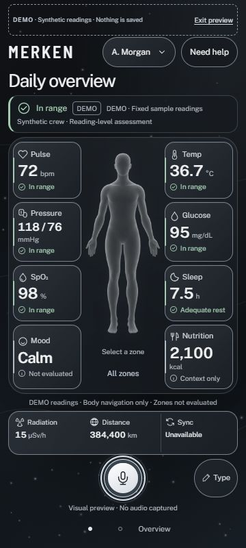

# Etapa 3 — micrófono integrado en la vista

**Pulido posterior:** [etapa 4: transiciones más suaves](../etapa-4/README.md), conservando esta composición y el flujo sin modal.

Se conserva el diseño híbrido y la cápsula centrada en reposo. La pulsación ya no abre un diálogo: el botón se recoge a un círculo de 56 px con dos halos suaves y un texto debajo. Al soltar recupera la cápsula y anuncia la disponibilidad de voz en esa misma zona.

La hoja `voice-dialog` queda exclusivamente para la escritura manual elegida mediante Type. Se retiraron los paneles de pulsación/revisión antiguos y la referencia del micrófono a un popup. El formulario y su lógica de guardado no cambian; pulsar el micrófono tampoco reinicia un borrador manual.

El estado de voz se mantiene dentro de la misma vista, sin mover el foco fuera del botón ni desplazar el resto de la pantalla. Se reserva una línea de estado para evitar saltos; los espacios móviles se compactan ligeramente para conservar el ajuste a una pantalla.

## Partículas

- Densidad base aproximadamente un 50 % mayor: 72 partículas en 360 × 800, con límite de 126 según superficie.
- Una órbita local de 14 puntos acompaña el halo mientras aumenta la energía de pulsación. Al soltar se disipa suavemente.
- Se conservan Canvas 2D, objetivo de 30 dibujos/s, límite de DPR y pausas de la etapa anterior. Sin librerías nuevas.
- La animación representa actividad del botón. No se captura audio ni se infieren amplitud, palabras o temas. La interfaz lo indica explícitamente.

## Validación en navegador

| Perfil representativo | Reposo, pulsación y liberación | Centro del control | Salto de altura |
| --- | --- | --- | --- |
| Samsung 360 × 800 | Sin scroll ni modal | 180 px | 0 px |
| Pixel 412 × 915 | Sin scroll ni modal | 206 px | 0 px |
| Pro Max 430 × 932 | Sin scroll ni modal | 215 px | 0 px |

- Pulsaciones nativas de ratón mantenidas entre 1.1 y 1.5 segundos: círculo activo, texto debajo, foco en el control y retorno a reposo. Se capturó el estado durante la pulsación real, no solamente después de soltar.
- Teclado Space/Enter y cancelación con Escape. Cancelación de puntero y pérdida de foco verificadas; el cambio de visibilidad se simuló. Se desactiva también el estado visual de partículas al cancelar.
- Type funciona por ratón y teclado. El borrador manual se conserva tras usar el micrófono. En preview el guardado sigue deshabilitado; no se crearon registros.
- Movimiento reducido emulado: halos sin animación y contador de dibujos constante. El círculo continúa visible.
- Texto raíz al 200 %: reflujo y desplazamiento vertical, con micrófono centrado en el ancho de contenido y mensaje antes de Type.
- Ningún recorte en tarjetas ni contenido de los controles en reposo. El halo se dibuja deliberadamente fuera de los límites del botón: el `scrollWidth` de ese botón durante la pulsación incluye el adorno, sin recortarlo ni generar scroll de página.
- Sin errores ni advertencias de consola durante la revisión final.
- TypeScript/Vite y comprobación de whitespace correctos.

Muestra breve del renderizador en escritorio, con 72 partículas: 60 dibujos en unos 2003 ms (29.95/s), p95 de 0.30 ms de CPU para dibujar/enviar comandos. No mide GPU completa, consumo ni temperatura en un teléfono.

Los datos son sintéticos. Las pruebas no certifican dispositivos físicos, captura real ni trazabilidad. Los cambios de trazabilidad que entran en paralelo pertenecen a otra integración y no se revisan en esta etapa.

Resultados detallados: [validacion.json](validacion.json). Captura animada: 30 imágenes reales a 6 fps, con diez fotogramas del estado mantenido y ningún modal abierto; conserva 360 × 800 sin estirar.

## Imágenes

- [Reposo](microfono-reposo-360x800.jpg)
- [Activo en Samsung](microfono-activo-360x800.jpg)
- [Activo en Pixel](microfono-activo-412x915.jpg)
- [Activo en Pro Max](microfono-activo-430x932.jpg)
- [Transición animada](microfono-integrado.gif)

## Pendiente

Conectar audio real y su energía al halo; después, transcripción y reacción a temas. La interfaz de trazabilidad se revisará por separado cuando su integración esté lista. No se añadió navegación nueva ni se modificó el contrato de registros.
