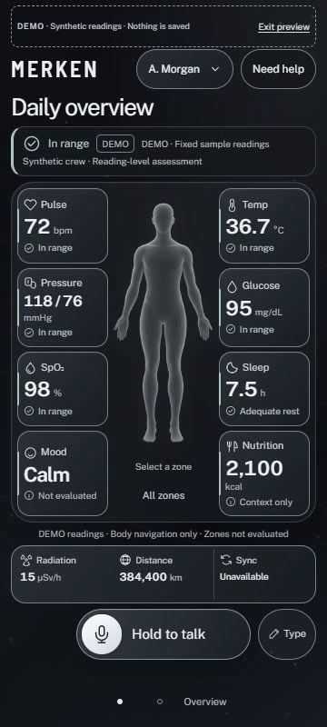

# Etapa 4 — pulido de movimiento

Última iteración visual de esta tanda: se mantienen composición, controles y densidad de partículas, con transiciones menos bruscas. Los únicos cambios de producto están en los estilos del micrófono y el renderizador decorativo.

- Cápsula y círculo se interpolan durante **480 ms**, con entrada y salida suaves y centro fijo.
- La etiqueta se desvanece antes de que falte espacio y reaparece cuando la cápsula ya puede mostrarla completa.
- Halos con respiración de **3.2 y 4.4 segundos**, expansión menor y menos brillo. Aparecen y se desvanecen gradualmente en vez de crearse/eliminarse de golpe.
- Menor velocidad y atracción de las partículas, conservando su cantidad. Aceleración y desaceleración suaves; la atracción continúa disipándose después de soltar.
- Órbita local más lenta, menos variación de tamaño y luminosidad. Las partículas se atenúan en los bordes para evitar apariciones bruscas al reiniciar su recorrido.
- El impulso de selección entra suavemente durante unos 300 ms y termina a los dos segundos, con menor intensidad.

No cambia el flujo de pulsación, la escritura manual, el guardado ni los estados de salud. La animación continúa representando actividad del botón: audio real y trazabilidad siguen fuera de esta entrega.

## Verificación

- Navegador a **360 × 800, 412 × 915 y 430 × 932**: vista completa, sin modal, control centrado y altura del área de entrada constante (78 px).
- Muestreo durante una pulsación nativa: ancho decreciente hasta 56 px y creciente al soltar, con el centro fijo dentro del redondeo de píxeles. El halo y la energía de partículas entran y salen gradualmente.
- Dos toques cortos consecutivos recuperan cápsula, etiqueta y estado de reposo correctamente.
- Movimiento reducido emulado: transiciones y halos sin animación; Canvas sin nuevos dibujos.
- La selección activa el impulso temporal y éste termina por sí solo.
- Captura de 75 fotogramas a 15 fps: ningún modal, desplazamiento de página ni texto visible recortado durante la transición.
- Sin errores ni advertencias de consola durante la revisión final.
- TypeScript/Vite y whitespace comprobados; la publicación valida una copia aislada de los cambios de esta iteración.

Muestra breve en escritorio, con 72 partículas: **29.98 dibujos/s**, p95 de **0.20 ms de CPU** para dibujar/enviar comandos. Es una medición de desarrollo, sin certificar GPU, consumo o dispositivos físicos.

Los cambios de trazabilidad presentes en paralelo se mantienen aparte, incluyendo su bloque de estilos compartido. Se conserva el objetivo de 30 dibujos/s y los límites de resolución de etapas anteriores. No se añadieron librerías.

Medidas: [validacion.json](validacion.json). Capturas: [reposo](reposo-360x800.jpg), [activo](activo-360x800.jpg) y [movimiento](animaciones-suaves.gif).

