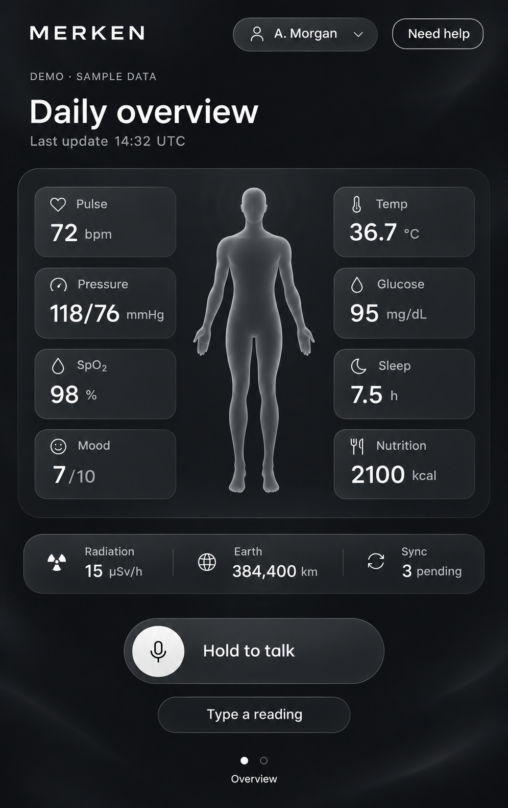
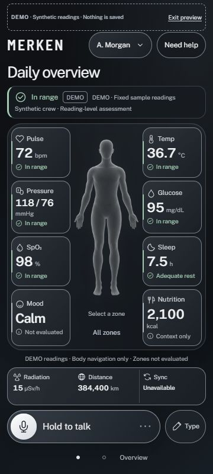
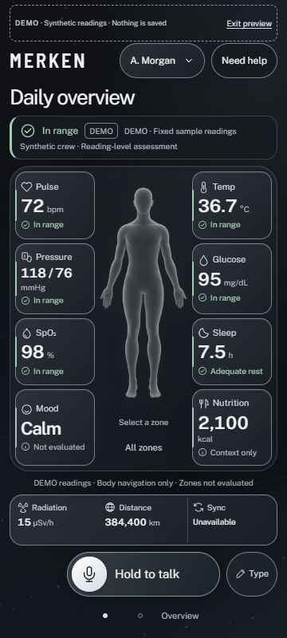
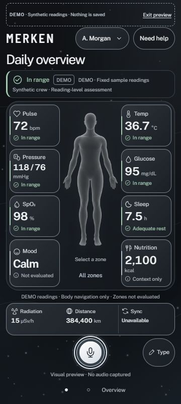
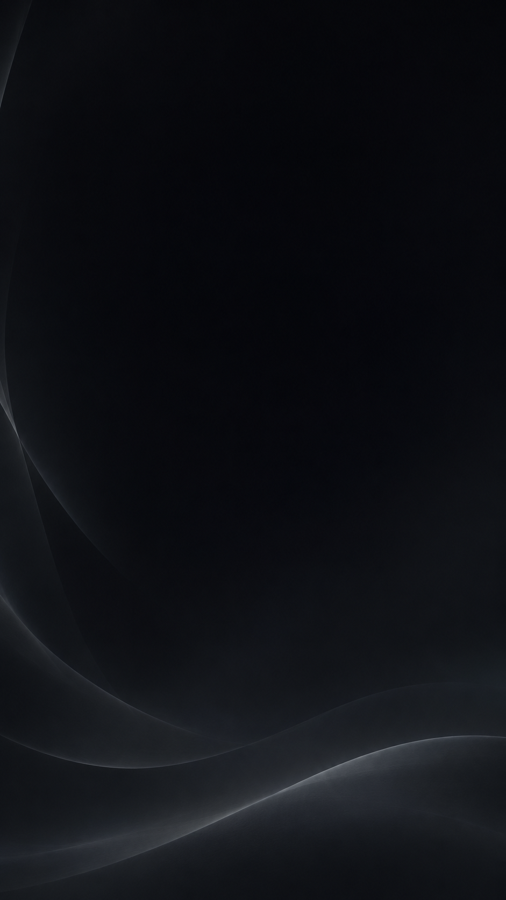
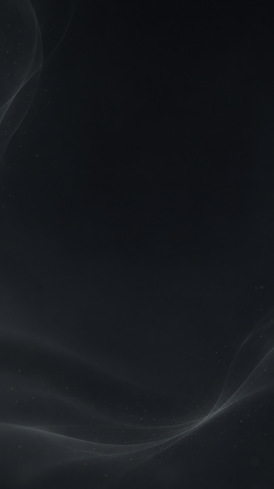
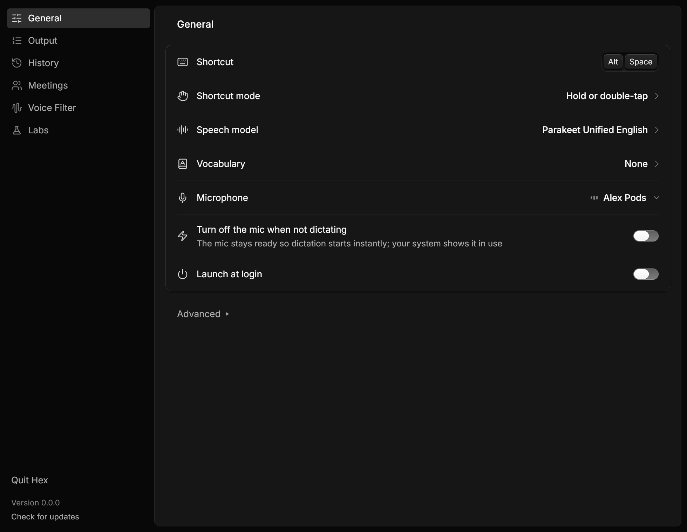
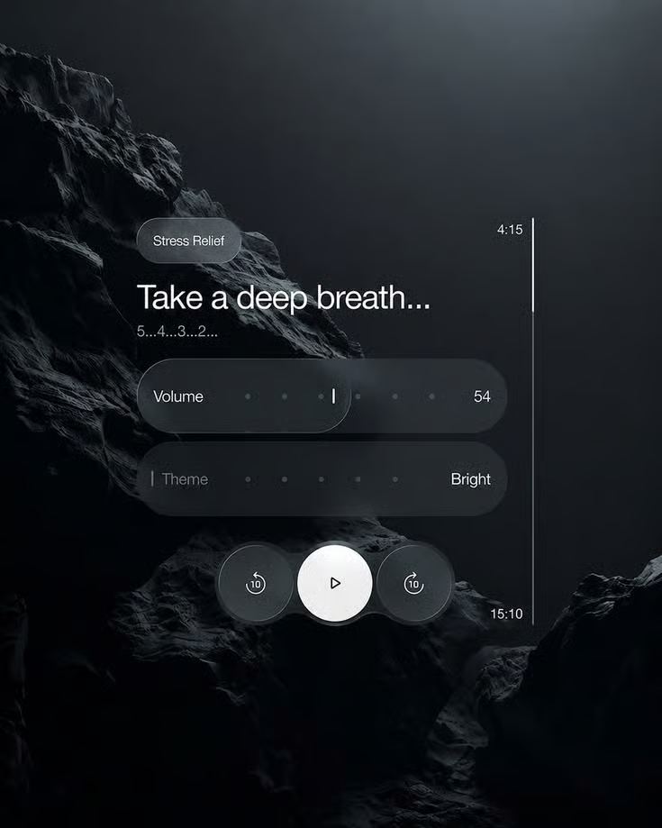

# Pulsys — lineamientos de diseño para el frontend

Material de traspaso para desarrollar un frontend separado manteniendo la estética que estamos explorando. El texto está en español para el equipo; la interfaz de la app va en inglés.

**Alcance aclarado por el usuario: el producto es exclusivamente una app móvil. No hay entrega web ni de escritorio. El navegador y las ventanas de desarrollo son herramientas para revisar la interfaz móvil.**

**Punto de partida: el diseño híbrido, sin el paisaje rocoso.** Esta es la base elegida por el usuario por ahora. Las imágenes son conceptos generados, no capturas de una implementación terminada ni especificaciones exactas al píxel.

Este paquete reúne las decisiones y ejemplos. Ya existe una base móvil compacta, una figura generada transparente y partículas Canvas 2D que reaccionan a pulsación/selección; captura de voz, transcripción e interpretación siguen pendientes.

## 1. Abrir primero esta imagen



**Archivo principal:** `imagenes/00-base-elegida-hibrido-sin-rocas.png`.

Tomar de aquí la composición, el contraste, las superficies, las proporciones generales y el tratamiento del micrófono. Conservar la identidad visual al adaptarlo a otras pantallas. Las cifras son datos ficticios de demostración, no valores que deban quedar fijos en la app.

## 2. Qué se decidió y qué sigue abierto

| Aspecto | Estado |
| --- | --- |
| Dirección general | Híbrido entre la sobriedad de Hex y el vidrio esmerilado de la referencia del usuario. |
| Composición exterior | Al usuario le gustó la estructura general del híbrido: cabecera, tarjetas, cuerpo y controles. Conservarla como base. |
| Fondo rocoso o paisaje | Descartado. No trasladarlo al frontend nuevo. |
| Fondo abstracto | Explorar flujo, ondas y partículas tenues generadas por código. La variante final no está elegida. |
| Micrófono | Se pidió una reacción visual al tocarlo y ondas que respondan a la voz cuando exista captura real. |
| Tema de conversación | Se pidió como efecto extra que las partículas cambien su movimiento según el tema reconocido. |
| Cantidad de efectos | Preparar una versión visual completa para experimentar y después optimizar con mediciones. |
| Librerías | Se discutieron alternativas; no se instaló ni eligió una de forma definitiva. |

Las asociaciones exactas entre temas y movimientos, los tiempos y la cantidad de partículas siguen siendo propuestas. No confundirlas con decisiones cerradas.

## 3. Lenguaje visual común

- Oscuro, sobrio, tranquilo y con sensación de profundidad.
- Fondo casi negro o carbón; blancos suaves y grises plateados para el contenido.
- Vidrio ahumado o esmerilado, con transparencia moderada y una base suficientemente oscura para leer.
- Iluminación ambiental suave, bordes finos y pequeños reflejos de contorno.
- Tarjetas con esquinas redondeadas; micrófono y selectores con forma de cápsula.
- Valores claros, alineación cuidada, unidades más discretas y bastante espacio entre grupos.
- Iconos de línea coherentes entre sí.
- La figura humana y las lecturas son el centro de la pantalla.

Evitar paisaje, rocas, fondos recargados, neón, cuadrículas de ciencia ficción, efectos holográficos, sombras duras, brillos intensos, ruido/grano excesivo y animaciones constantes en todos los controles.

### Superficies y capas

1. **Fondo:** carbón profundo con textura abstracta muy tenue.
2. **Campo animado:** ondas o partículas detrás del contenido, sin capturar los toques.
3. **Paneles:** superficies oscuras translúcidas con borde visible.
4. **Contenido:** texto e iconos nítidos; las cifras no deben deformarse con el fondo.
5. **Diálogos y hojas:** mayor opacidad, con jerarquía clara respecto del resto.

El desenfoque sirve para dar materialidad. Una capa oscura de respaldo debe mantener la lectura si el efecto no está disponible. Evitar acumular vidrio sobre vidrio hasta perder contraste.

## 4. Color, tipografía y medidas

El repositorio ya tiene tokens de marca. Conservar sus colores de estado y usar una sola fuente de tokens en el frontend nuevo. El nuevo acabado puede ajustar las superficies y redondeados sin cambiar el significado de los estados.

### Base existente en el repo

| Uso | Valor de referencia |
| --- | --- |
| Fondo de marca | `#171717`; el concepto permite profundizarlo hacia carbón casi negro. |
| Superficie | `#222222` |
| Superficie elevada | `#2D2D2D` |
| Texto principal | `#EEECE8` |
| Texto secundario | `#C0BBB3` |
| Acción y foco | `#C2CDE0` |
| Estable | `#A5CCB3` sobre `#1C3028` |
| Cambio | `#E8C27D` sobre `#352C1D` |
| Alarma | `#F0A2A2` sobre `#382226` |
| Sin evaluación/contexto | `#B2BDC8` sobre `#252E38` |

Estos son los tokens existentes, no colores extraídos de las imágenes generadas. Las transparencias finales deben verificarse sobre el fondo real. El color de salud va acompañado de texto e icono. El fondo decorativo permanece neutral; conexión y sincronización no reutilizan colores de salud para insinuar una evaluación.

### Tipografía existente

- **Public Sans 400/600:** interfaz, etiquetas y botones.
- **Roboto Mono 400:** cifras y datos cuando sea útil para mantener alineación.
- **Barlow Semi Condensed 600:** marca PULSYS y títulos según la jerarquía existente.
- Empaquetar fuentes localmente para funcionar sin conexión.

Las imágenes generadas orientan el estilo, pero no garantizan que cada glifo coincida con estas familias. Usar las fuentes reales del proyecto en la implementación.

### Medidas iniciales propuestas

- Espaciado sobre una escala de 4/8 px; márgenes móviles de 12–20 px según el ancho disponible.
- Tarjetas: radio aproximado de 16–24 px, adaptable al ancho.
- Panel principal: radio aproximado de 24–32 px.
- Cápsulas: radio completo, conservando una zona de toque cómoda.
- Objetivos interactivos de al menos 44 × 44 px.
- Valores más grandes que las etiquetas y unidades. Permitir reflujo y crecimiento de altura con texto largo o zoom.

Los tamaños son puntos de partida para probar, no una obligación de encajar la pantalla a costa de ocultar información.

## 5. Composición de la pantalla principal

De arriba abajo:

1. **Cabecera:** PULSYS, selector de tripulante y `Need help`, siempre fácil de encontrar.
2. **Encabezado:** `Daily overview` o un título equivalente, con estado general, actualización y marca DEMO cuando corresponda. El estado general debe provenir del servicio que lo evalúa.
3. **Panel central:** figura humana con tarjetas a ambos lados.
4. **Contexto:** radiación, distancia a Tierra y sincronización en un grupo más compacto y neutral.
5. **Entrada:** cápsula del micrófono con `Hold to talk` y acceso alternativo `Type a reading`. En móvil comparten una fila y el segundo se abrevia visualmente a `Type`, conservando su nombre accesible completo.
6. **Navegación secundaria:** puntos o controles discretos hacia historial y otras pantallas.

| Lado izquierdo | Centro | Lado derecho |
| --- | --- | --- |
| Pulse | Figura humana | Temperature |
| Pressure | Figura humana | Glucose |
| SpO₂ | Figura humana | Sleep |
| Mood | Figura humana | Nutrition |

Tocar una zona puede resaltar las tarjetas relacionadas; tocar una tarjeta abre su detalle e historial. El estado de una zona se obtiene del núcleo, no del efecto visual ni de una asociación de navegación.

Priorizar la pantalla principal móvil y detalles en hojas. La barra lateral de Hex se usa como referencia de lenguaje visual; no se propone una versión web ni de escritorio del producto.

### Adaptación actual a una pantalla

La vista principal entra completa, con texto inicial y muestras sintéticas, en los perfiles de navegador 360 × 800 (Samsung), 412 × 915 (Pixel) y 430 × 932 (Pro Max). Son dimensiones representativas en píxeles CSS, pendientes de prueba en teléfonos físicos.

Usar cabecera compacta, un título sin lema adicional, tarjetas que aprovechan el alto disponible, contexto bajo y entrada en una fila. Conservar la proporción de la ilustración y el tinte de selección. Los accesos Back y Other están en All zones, cuya lista conserva las 14 zonas. El estado visible de Mood se abrevia a Not evaluated; su detalle y nombre accesible conservan Self-reported · Not evaluated.

Respetar áreas seguras y mantener controles HTML de al menos 44 × 44 px. Permitir reflujo y scroll en pantallas pequeñas, texto ampliado, historial y avisos. No ocultar ni recortar información para forzar una altura. En la implementación actual, un ancho efectivo menor o igual a 19 rem reorganiza el cuerpo encima de tarjetas en dos columnas.



**Actualización posterior:** `Hold to talk` queda centrado respecto de toda la pantalla, con espacio simétrico y `Type` a la derecha. La capa Canvas usa partículas grises y corrientes tenues detrás del vidrio. Acelera suavemente al mantener pulsado y da un impulso local al seleccionar una zona; no representa voz ni un estado clínico. Se pausa fuera de la vista principal y al ocultarse; respeta movimiento reducido. La versión actual no añade librerías y sigue entrando en los tres perfiles. Captura actual y muestra animada:



[Ver muestra del movimiento en reposo](imagenes/18-particulas-en-reposo.gif).

**Estado más reciente del micrófono:** se conserva la cápsula en reposo; al mantener pulsado se recoge a un círculo centrado con halos y el mensaje debajo, dentro de la misma vista. Al soltar vuelve a la cápsula. La escritura manual se abre solo al elegir Type; el micrófono ya no abre una pantalla. Mantener el foco, las áreas táctiles y el alto reservado para evitar saltos. Las partículas tienen un poco más de presencia y una órbita local durante la pulsación. Es una vista previa de actividad, todavía sin audio ni interpretación de voz.



[Ver transición de reposo a pulsación y regreso](imagenes/20-microfono-integrado.gif).

**Pulido final de esta tanda:** transición cápsula/círculo de 480 ms, centro fijo, etiqueta que entra cuando tiene espacio y halos más tenues con respiración lenta. Las partículas conservan su cantidad y suavizan velocidad, atracción y salida; se atenúan en los bordes. Evitar saltos de forma, destellos instantáneos y cortes de movimiento al soltar. Se respeta movimiento reducido.

[Ver la transición suavizada actual](imagenes/21-animaciones-suaves.gif).

### Figura humana

Silueta clara, proporcionada y discreta, con acabado gris translúcido y contornos suaves. La figura visible de esta iteración es una imagen generada con transparencia, con una capa SVG separada para las zonas seleccionables.

**Dirección actual:** el usuario no quedó conforme con el dibujo SVG y pidió generar y recortar una figura más cercana a la referencia. Usar `imagenes/15-cuerpo-generado-transparente.png` como ilustración; conservar sus proporciones y su transparencia. En la app se usa una versión WebP y un contorno obtenido del alfa para recortar las áreas de selección. El archivo `14-cuerpo-humano-continuo.svg` es un intento anterior descartado como acabado visual, conservado solo para comparación.

**Selección:** resaltar la zona con un tinte suave, sin recuadros ni contornos de foco alrededor de las áreas invisibles. La figura debe aprovechar el alto del panel; ampliar imagen y zonas juntas, manteniendo las proporciones. Ajustar las tarjetas por parejas de filas para reducir espacio vacío sin desalinear ambos lados.

El contrato actual distingue cabeza, cuello, pecho, abdomen, espalda, brazo izquierdo/derecho, mano izquierda/derecha, pierna izquierda/derecha, pie izquierdo/derecho y otros: 14 zonas. Izquierda/derecha se refieren al cuerpo de la persona. Mantener acceso alternativo en lista para zonas pequeñas y uso con teclado.

## 6. Fondos que se exploraron

Los siguientes archivos son **referencias estáticas de material y composición**. El movimiento y la interacción se implementan por código; estas imágenes no se animan como fondos de video.

| Flujo suave | Partículas | Ondas difusas |
| --- | --- | --- |
|  |  |  |
| Corrientes amplias y oscuras; candidato para reposo. | Partículas finas cerca de los bordes; candidato para interacción. | Ondas suaves que se disipan; candidato para selección y micrófono. |

Una posibilidad propuesta es combinar flujo lento habitual con ondas localizadas y partículas reactivas. Ninguna de las tres está elegida definitivamente como fondo.

## 7. Movimiento y micrófono

| Momento | Comportamiento propuesto |
| --- | --- |
| Reposo | Desplazamiento muy lento y de poca intensidad. |
| Toque o pulsación del micrófono | Onda breve que nace cerca del control. |
| Captura real de voz | La energía de audio modifica suavemente amplitud y velocidad. |
| Soltar el control | La actividad pierde intensidad; aparece revisión cuando haya contenido que revisar. |
| Seleccionar una zona/tarjeta | Reacción localizada, sin tapar texto ni mover las cifras. |
| Página oculta | Pausar el efecto. |
| Movimiento reducido | Presentación estática o respuesta mínima que conserve el flujo funcional. |

**Distinguir pulsación de captura:** tocar el micrófono puede activar una animación, pero eso no significa que exista audio. La interfaz debe informar la disponibilidad real y no inventar transcripciones o guardados.

### Movimiento según el tema de conversación

Son dos señales distintas: el análisis de audio mide intensidad; entender el tema requiere texto transcrito o una entrada equivalente. La categoría visual se actualiza por segmentos estables, no por fotograma.

| Tema | Ejemplo para explorar |
| --- | --- |
| Sueño/descanso | Ondas amplias y lentas. |
| Actividad/ejercicio | Flujo más dirigido, con intensidad acotada. |
| Ánimo | Expansión y agrupación suaves. |
| Zona corporal mencionada | Concentración ligera junto a la zona, sin simular una evaluación. |
| Tema ambiguo/desconocido | Mantener el patrón neutral. |

Estas asociaciones son propuestas abiertas. Cambiar entre ellas gradualmente y evitar saltos por cada palabra. Si solo hay transcripción al terminar, la reacción al tema llegará después; no prometer interpretación semántica instantánea.

Reutilizar la transcripción y el intérprete del registro cuando estén disponibles. No hace falta cargar un modelo adicional solo para decorar el fondo. La entrada se revisa antes de guardarse; el efecto no confirma campos ni registra datos de salud.

## 8. Librerías discutidas y rendimiento

Este documento no obliga a usar un framework. El frontend actual usa TypeScript, Vite y Tauri 2, con lógica de salud en Rust.

| Opción | Uso que se discutió |
| --- | --- |
| CSS/SVG | Vidrio, luces, controles y ondas sencillas. |
| Canvas 2D | Partículas y curvas animadas. |
| Motion | Transiciones y coordinación de animaciones; opcional. |
| OGL/WebGL | Flujo y deformaciones mediante shaders si el acabado lo requiere. |
| PixiJS | Alternativa para una escena 2D con más capas y partículas. |
| Web Audio / AnalyserNode | Datos de amplitud para reacción a voz; no interpreta temas. |

Se pidió probar una versión con los efectos completos y optimizar después. Conservar interruptores de efectos/calidad para comparar. Respetar movimiento reducido y pausa fuera de vista desde el principio.

Medir cuatro escenarios comparables en el mismo dispositivo: interfaz sin efectos; efectos con temas simulados; efectos con micrófono; efectos con transcripción real cuando exista. Comparar tamaño del build, RAM, CPU/GPU, tiempos por fotograma, respuesta de controles y latencia voz-a-tema. En Android medir sesiones sostenidas para temperatura y consumo.

Ya existe una primera muestra breve en navegador de escritorio para el Canvas actual: 120 dibujos en unos cuatro segundos (29.99/s), con 0.10 ms p50 y 0.20 ms p95 de tiempo CPU de dibujo/envío de comandos. No mide GPU completa ni consumo móvil. La combinación con audio/transcripción y las sesiones sostenidas en teléfonos siguen pendientes. Las cantidades de partículas y el objetivo de 30 dibujos/s son parámetros ajustables de esta primera versión, no garantías de rendimiento. Evitar afirmar que el efecto es liviano por su apariencia.

## 9. Límites funcionales que el diseño debe respetar

- Todos los textos de la app en inglés; documentación del equipo en español.
- Las evaluaciones y alarmas las decide `pulsys-core`; las animaciones no cambian estados.
- Los datos sintéticos deben llevar DEMO de forma visible.
- Las tarjetas del tripulante MySQL y los síntomas del perfil local son fuentes distintas en la implementación actual. No asumir que están vinculados.
- La pérdida de conexión no convierte una alarma en un estado favorable. Mantener hora y origen de la información.
- `Need help` permanece accesible y explica qué acción puede ejecutar realmente.
- El registro manual sigue disponible cuando no hay voz/modelo. Revisar la interpretación antes de guardar.
- No representar con una animación una capacidad que todavía no está disponible.

## 10. Accesibilidad y adaptación

Verificar los perfiles 360 × 800, 412 × 915 y 430 × 932 para la vista principal sin scroll con texto inicial. Revisar también 320 × 568, texto al 200 % y mensajes largos: allí se permite desplazamiento vertical para preservar la lectura. No reducir toda la interfaz ni ocultar información para forzar una altura.

Usar foco visible, navegación por teclado, etiquetas accesibles y alternativa de lista al mapa corporal. Los diálogos deben conservar su foco y devolverlo al cerrarse. Los fondos decorativos deben ser ignorados por lectores de pantalla y no interceptar interacción.

Comprobar contraste sobre las capas reales y durante las animaciones: texto habitual al menos 4.5:1 y controles/foco esenciales al menos 3:1 cuando corresponda. Las imágenes de IA no certifican accesibilidad.

## 11. Referencias originales y exploraciones

### Hex

De Hex tomamos superficies oscuras tranquilas, jerarquía, espacio, iconos de línea, controles agrupados y cápsulas compactas.




Las capturas de cápsulas incluidas son del flujo de captura/grabación de pantalla de Hex; no confundirlas con su indicador de dictado. `11-referencia-hex-ajustes-hud.png` muestra ajustes del HUD, no el indicador flotante funcionando.

### Referencia de vidrio aportada por el usuario



Se tomó su vidrio, iluminación y sensación de profundidad. Su paisaje no forma parte de la dirección elegida.

Prompt de referencia original, conservado para contexto:

```text
minimal dark mobile app UI, glassmorphism aesthetic with frosted glass elements,
soft ambient lighting, a monochromatic color palette with subtle highlights,
layered composition creating depth, calm and serene mood,
sleek rendering technique emphasizing transparency and smoothness

Negative: low contrast, cluttered layout, harsh shadows, bright colors,
busy backgrounds, watermarks, pixelation, excessive text

Parameters: --ar 9:16 --style raw --stylize 250
```

Los parámetros pertenecen al prompt compartido. No son requisitos del frontend ni parámetros nativos de la herramienta con la que generamos los conceptos.

### Índice de imágenes

| Archivo en `imagenes/` | Cómo usarlo |
| --- | --- |
| `00-base-elegida-hibrido-sin-rocas.png` | **Referencia principal elegida por ahora.** |
| `01-fondo-flujo-suave.png` | Explorar textura y movimiento lento. |
| `02-fondo-particulas.png` | Explorar partículas e interacción. |
| `03-fondo-ondas-difusas.png` | Explorar ondas y profundidad. |
| `04-referencia-hex-interfaz.png` | Jerarquía, superficies y controles de Hex. |
| `05-referencia-hex-capsula-grabando.png` | Forma, proporción y acciones de una cápsula. |
| `06-referencia-usuario-vidrio.png` | Material e iluminación de la referencia inicial. |
| `07-exploracion-hex-sobrio.png` | Alternativa anterior para comparar; no es la base elegida. |
| `08-exploracion-vidrio-ambiental.png` | Alternativa anterior; su paisaje no se conserva. |
| `09-hibrido-anterior-fondo-descartado.png` | Evolución del híbrido; **fondo rocoso descartado**. |
| `10-referencia-hex-historial.png` | Referencia para historial y vista de detalle. |
| `11-referencia-hex-ajustes-hud.png` | Referencia de ajustes y controles segmentados. |
| `12-referencia-hex-procesando.png` | Estado compacto de procesamiento. |
| `13-referencia-hex-selector.png` | Selector contextual desplegable. |
| `14-cuerpo-humano-continuo.svg` | Intento anterior de dibujo SVG; no es la ilustración elegida. |
| `15-cuerpo-generado-transparente.png` | **Figura actual generada y recortada**, sin fondo; usar con áreas interactivas separadas. |
| `16-ui-movil-compacta.jpg` | Captura de la implementación móvil compacta, con datos DEMO, sin scroll en 360 × 800. |
| `17-ui-particulas.jpg` | Captura posterior con micrófono centrado y partículas detrás de la interfaz. |
| `18-particulas-en-reposo.gif` | Muestra animada de la implementación real; datos DEMO y movimiento en reposo. |
| `19-microfono-integrado.jpg` | Estado activo dentro de la vista, con halo y texto debajo, sin modal. |
| `20-microfono-integrado.gif` | Transición real entre cápsula en reposo, círculo mantenido y regreso. |
| `21-animaciones-suaves.gif` | Versión actual pulida: transición gradual, halo menos intenso y partículas más calmadas. |

## 12. Fuentes y entrega

Este Markdown y la carpeta `imagenes/` son autosuficientes: compartirlos juntos para conservar las referencias relativas. El paquete ZIP contiene ambos y la licencia de las capturas de Hex.

- Referencia de aplicación: [anomalyco/hex](https://github.com/anomalyco/hex).
- Capturas oficiales de Hex: [tests/golden, revisión 31feb6f0e8569700faea46ac54db083a535602cd](https://github.com/anomalyco/hex/tree/31feb6f0e8569700faea46ac54db083a535602cd/tests/golden). Se incluye `LICENSE-hex.txt`.
- La imagen de vidrio fue aportada por el usuario; no se atribuye a Hex ni se presenta como un recurso de producción con licencia comprobada.
- Los mockups de Pulsys y tres fondos se generaron con image_gen para esta exploración.
- Dentro del repo: `docs/brand/brandbook.md`, `docs/brand/tokens.css` y `docs/front/concepto-pantalla.md` sirven de contexto existente. Las decisiones actuales del usuario recogidas aquí orientan esta nueva iteración.
- Los prompts completos de nuestra generación siguen en `docs/front/conceptos/hex-glass/PROMPTS.md` y `docs/front/conceptos/hex-glass/fondos/PROMPTS.md` del repositorio original.

Para revisar la entrega del compañero: comparar primero con la imagen `00`, comprobar que no volvió el paisaje, recorrer las mismas tarjetas y controles, verificar contraste y adaptación móvil, y comprobar que toda simulación esté identificada.
